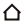

# Icons reference

The 27 brand icons: pixel-aligned on a 24 × 24 grid (20 × 20 safe area, 2px line), solid, single colour. Taupe Dark on light, Taupe Light on dark (change the SVG fill when placing), Pink only for an active state. Sizes 24, 48 or 96px; never below 16px. Inside UI visuals use Phosphor Regular instead. Use empty alt text beside a visible label; label the control for icon-only actions.

[Selection workflow](../ASSETS.md) · [Production rules](assets.md)

Generated from `assets/catalog.json`; do not edit rows manually. Exact IDs include the file format.

| Preview | Exact asset ID | File | Usage / size |
| --- | --- | --- | --- |
|  | `brand-2026.IconsGeneric.rasa-icon-agents.svg` | [Open SVG](../assets/brand-2026/IconsGeneric/rasa-icon-agents.svg) | current · derived · 10,155 bytes |
|  | `brand-2026.IconsGeneric.rasa-icon-approach.svg` | [Open SVG](../assets/brand-2026/IconsGeneric/rasa-icon-approach.svg) | current · derived · 1,142 bytes |
|  | `brand-2026.IconsGeneric.rasa-icon-arrow.svg` | [Open SVG](../assets/brand-2026/IconsGeneric/rasa-icon-arrow.svg) | current · derived · 4,082 bytes |
|  | `brand-2026.IconsGeneric.rasa-icon-bell.svg` | [Open SVG](../assets/brand-2026/IconsGeneric/rasa-icon-bell.svg) | current · derived · 6,846 bytes |
|  | `brand-2026.IconsGeneric.rasa-icon-book.svg` | [Open SVG](../assets/brand-2026/IconsGeneric/rasa-icon-book.svg) | current · derived · 6,931 bytes |
|  | `brand-2026.IconsGeneric.rasa-icon-challenge.svg` | [Open SVG](../assets/brand-2026/IconsGeneric/rasa-icon-challenge.svg) | current · derived · 589 bytes |
|  | `brand-2026.IconsGeneric.rasa-icon-check.svg` | [Open SVG](../assets/brand-2026/IconsGeneric/rasa-icon-check.svg) | current · derived · 527 bytes |
|  | `brand-2026.IconsGeneric.rasa-icon-chevron.svg` | [Open SVG](../assets/brand-2026/IconsGeneric/rasa-icon-chevron.svg) | current · derived · 499 bytes |
|  | `brand-2026.IconsGeneric.rasa-icon-clock.svg` | [Open SVG](../assets/brand-2026/IconsGeneric/rasa-icon-clock.svg) | current · derived · 7,104 bytes |
|  | `brand-2026.IconsGeneric.rasa-icon-close.svg` | [Open SVG](../assets/brand-2026/IconsGeneric/rasa-icon-close.svg) | current · derived · 1,288 bytes |
|  | `brand-2026.IconsGeneric.rasa-icon-customer-support.svg` | [Open SVG](../assets/brand-2026/IconsGeneric/rasa-icon-customer-support.svg) | current · derived · 5,842 bytes |
|  | `brand-2026.IconsGeneric.rasa-icon-developer-tools.svg` | [Open SVG](../assets/brand-2026/IconsGeneric/rasa-icon-developer-tools.svg) | current · derived · 362 bytes |
|  | `brand-2026.IconsGeneric.rasa-icon-heart.svg` | [Open SVG](../assets/brand-2026/IconsGeneric/rasa-icon-heart.svg) | current · derived · 6,025 bytes |
|  | `brand-2026.IconsGeneric.rasa-icon-home.svg` | [Open SVG](../assets/brand-2026/IconsGeneric/rasa-icon-home.svg) | current · derived · 1,053 bytes |
|  | `brand-2026.IconsGeneric.rasa-icon-mail.svg` | [Open SVG](../assets/brand-2026/IconsGeneric/rasa-icon-mail.svg) | current · derived · 3,478 bytes |
|  | `brand-2026.IconsGeneric.rasa-icon-next.svg` | [Open SVG](../assets/brand-2026/IconsGeneric/rasa-icon-next.svg) | current · derived · 492 bytes |
|  | `brand-2026.IconsGeneric.rasa-icon-padlock.svg` | [Open SVG](../assets/brand-2026/IconsGeneric/rasa-icon-padlock.svg) | current · derived · 9,215 bytes |
|  | `brand-2026.IconsGeneric.rasa-icon-plus.svg` | [Open SVG](../assets/brand-2026/IconsGeneric/rasa-icon-plus.svg) | current · derived · 1,290 bytes |
|  | `brand-2026.IconsGeneric.rasa-icon-results.svg` | [Open SVG](../assets/brand-2026/IconsGeneric/rasa-icon-results.svg) | current · derived · 432 bytes |
|  | `brand-2026.IconsGeneric.rasa-icon-search.svg` | [Open SVG](../assets/brand-2026/IconsGeneric/rasa-icon-search.svg) | current · derived · 7,168 bytes |
|  | `brand-2026.IconsGeneric.rasa-icon-skills.svg` | [Open SVG](../assets/brand-2026/IconsGeneric/rasa-icon-skills.svg) | current · derived · 5,376 bytes |
|  | `brand-2026.IconsGeneric.rasa-icon-star.svg` | [Open SVG](../assets/brand-2026/IconsGeneric/rasa-icon-star.svg) | current · derived · 1,201 bytes |
|  | `brand-2026.IconsGeneric.rasa-icon-studio.svg` | [Open SVG](../assets/brand-2026/IconsGeneric/rasa-icon-studio.svg) | current · derived · 5,204 bytes |
|  | `brand-2026.IconsGeneric.rasa-icon-tools.svg` | [Open SVG](../assets/brand-2026/IconsGeneric/rasa-icon-tools.svg) | current · derived · 4,357 bytes |
|  | `brand-2026.IconsGeneric.rasa-icon-user.svg` | [Open SVG](../assets/brand-2026/IconsGeneric/rasa-icon-user.svg) | current · derived · 7,502 bytes |
|  | `brand-2026.IconsGeneric.rasa-icon-voice-connected.svg` | [Open SVG](../assets/brand-2026/IconsGeneric/rasa-icon-voice-connected.svg) | current · derived · 7,271 bytes |
|  | `brand-2026.IconsGeneric.rasa-icon-voice.svg` | [Open SVG](../assets/brand-2026/IconsGeneric/rasa-icon-voice.svg) | current · derived · 5,338 bytes |
