# Patterns reference

Use primary patterns first. Light variants have light fields; Dark and Pink variants have dark fields. Keep text on a solid panel. These WebP derivatives are for web use; query matching SVG/PNG files for masters and other production workflows. Finite compositions are not certified seamless tiles.

[Selection workflow](../ASSETS.md) · [Production rules](assets.md)

Generated from `assets/catalog.json`; do not edit rows manually. Exact IDs include the file format.

## Primary

| Preview | Exact asset ID | File | Usage / size |
| --- | --- | --- | --- |
|  | `patterns.primary.web.chladni-01-dark.webp` | [Open WEBP](../assets/patterns/primary/web/chladni-01-dark.webp) | dark · 47,402 bytes |
|  | `patterns.primary.web.chladni-01-light.webp` | [Open WEBP](../assets/patterns/primary/web/chladni-01-light.webp) | light · 39,752 bytes |
|  | `patterns.primary.web.chladni-01-pink.webp` | [Open WEBP](../assets/patterns/primary/web/chladni-01-pink.webp) | pink · 147,556 bytes |
|  | `patterns.primary.web.chladni-02-dark.webp` | [Open WEBP](../assets/patterns/primary/web/chladni-02-dark.webp) | dark · 49,580 bytes |
|  | `patterns.primary.web.chladni-02-light.webp` | [Open WEBP](../assets/patterns/primary/web/chladni-02-light.webp) | light · 41,100 bytes |
|  | `patterns.primary.web.chladni-02-pink.webp` | [Open WEBP](../assets/patterns/primary/web/chladni-02-pink.webp) | pink · 153,560 bytes |
|  | `patterns.primary.web.soundwave-01-dark.webp` | [Open WEBP](../assets/patterns/primary/web/soundwave-01-dark.webp) | dark · 29,146 bytes |
|  | `patterns.primary.web.soundwave-01-light.webp` | [Open WEBP](../assets/patterns/primary/web/soundwave-01-light.webp) | light · 24,260 bytes |
|  | `patterns.primary.web.soundwave-01-pink.webp` | [Open WEBP](../assets/patterns/primary/web/soundwave-01-pink.webp) | pink · 91,250 bytes |
|  | `patterns.primary.web.soundwave-02-dark.webp` | [Open WEBP](../assets/patterns/primary/web/soundwave-02-dark.webp) | dark · 28,660 bytes |
|  | `patterns.primary.web.soundwave-02-light.webp` | [Open WEBP](../assets/patterns/primary/web/soundwave-02-light.webp) | light · 24,084 bytes |
|  | `patterns.primary.web.soundwave-02-pink.webp` | [Open WEBP](../assets/patterns/primary/web/soundwave-02-pink.webp) | pink · 89,810 bytes |

## Additional

| Preview | Exact asset ID | File | Usage / size |
| --- | --- | --- | --- |
|  | `patterns.additional.web.bold-loops-dark.webp` | [Open WEBP](../assets/patterns/additional/web/bold-loops-dark.webp) | dark · 34,524 bytes |
|  | `patterns.additional.web.bold-loops-light.webp` | [Open WEBP](../assets/patterns/additional/web/bold-loops-light.webp) | light · 30,684 bytes |
|  | `patterns.additional.web.bold-loops-pink.webp` | [Open WEBP](../assets/patterns/additional/web/bold-loops-pink.webp) | pink · 103,630 bytes |
|  | `patterns.additional.web.broad-diamonds-dark.webp` | [Open WEBP](../assets/patterns/additional/web/broad-diamonds-dark.webp) | dark · 52,928 bytes |
|  | `patterns.additional.web.broad-diamonds-light.webp` | [Open WEBP](../assets/patterns/additional/web/broad-diamonds-light.webp) | light · 46,958 bytes |
| 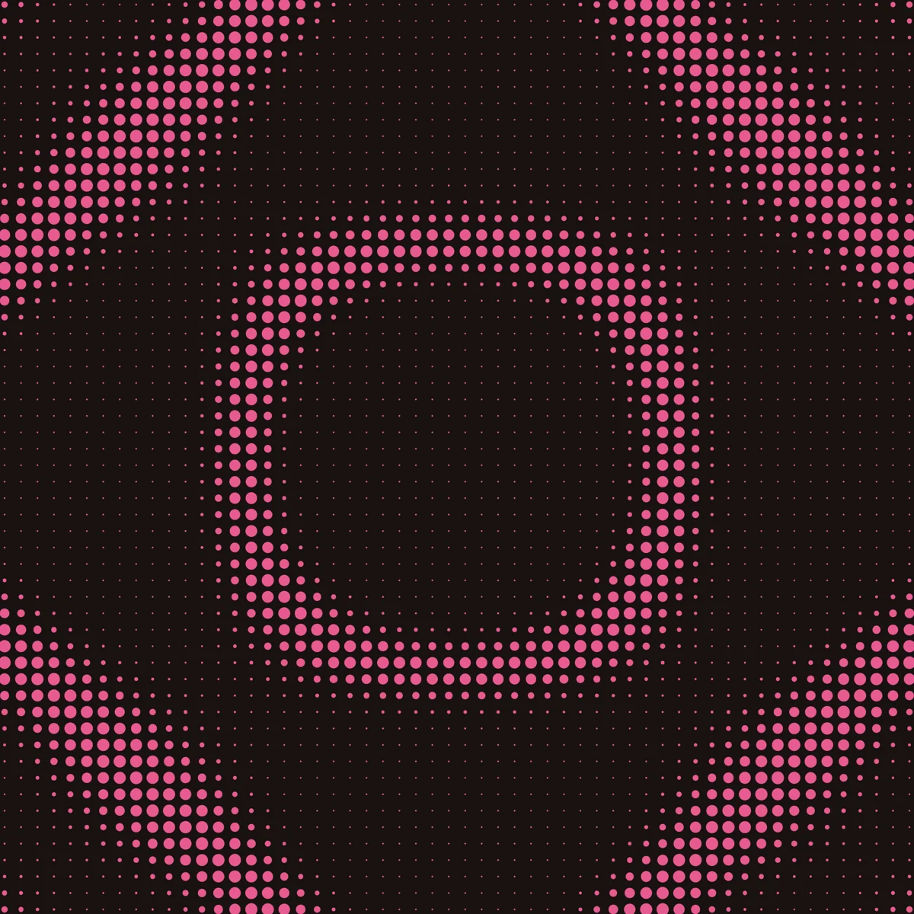 | `patterns.additional.web.broad-diamonds-pink.webp` | [Open WEBP](../assets/patterns/additional/web/broad-diamonds-pink.webp) | pink · 166,136 bytes |
| 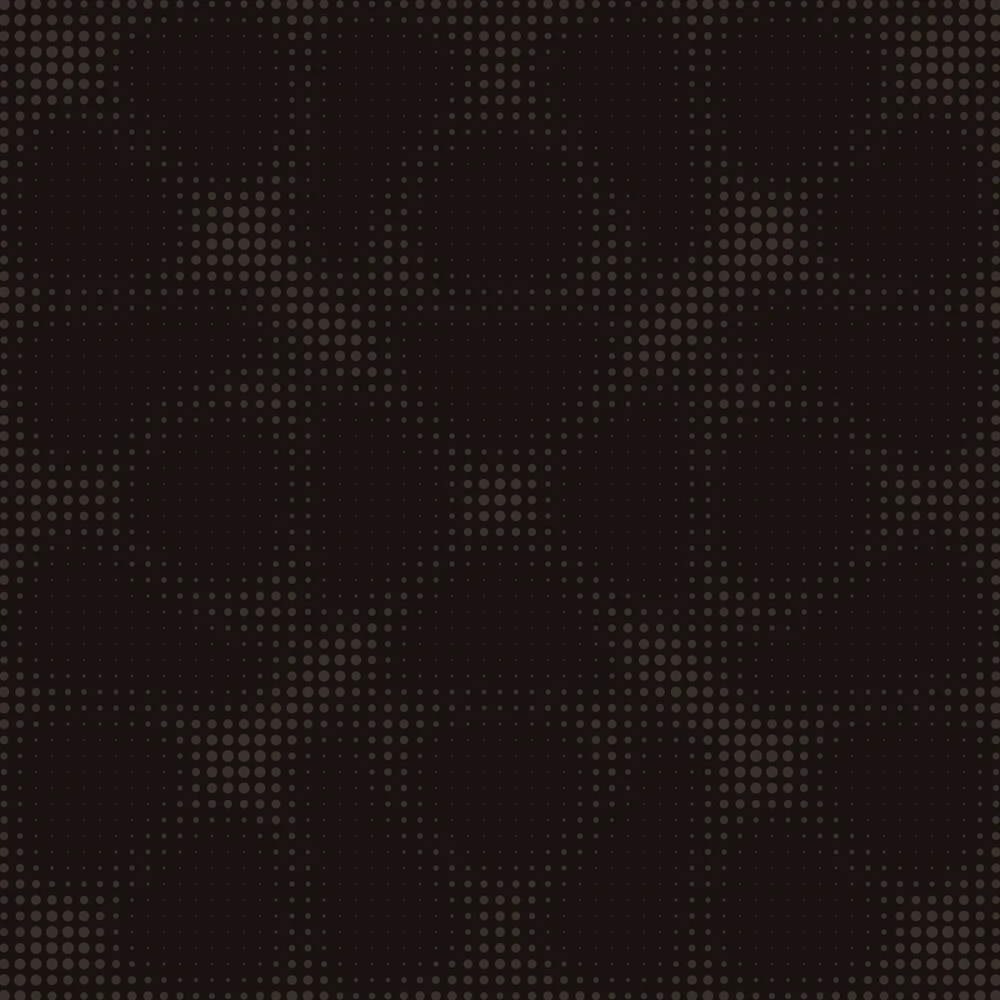 | `patterns.additional.web.crossed-bands-dark.webp` | [Open WEBP](../assets/patterns/additional/web/crossed-bands-dark.webp) | dark · 67,442 bytes |
|  | `patterns.additional.web.crossed-bands-light.webp` | [Open WEBP](../assets/patterns/additional/web/crossed-bands-light.webp) | light · 58,270 bytes |
| 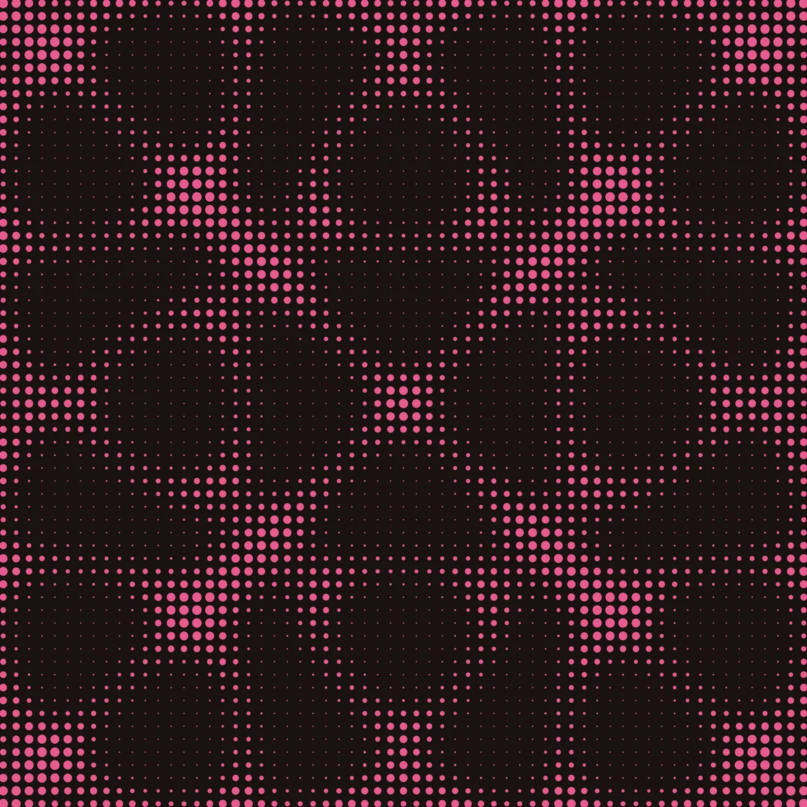 | `patterns.additional.web.crossed-bands-pink.webp` | [Open WEBP](../assets/patterns/additional/web/crossed-bands-pink.webp) | pink · 207,100 bytes |
|  | `patterns.additional.web.dense-weave-dark.webp` | [Open WEBP](../assets/patterns/additional/web/dense-weave-dark.webp) | dark · 119,190 bytes |
|  | `patterns.additional.web.dense-weave-light.webp` | [Open WEBP](../assets/patterns/additional/web/dense-weave-light.webp) | light · 92,844 bytes |
|  | `patterns.additional.web.dense-weave-pink.webp` | [Open WEBP](../assets/patterns/additional/web/dense-weave-pink.webp) | pink · 384,460 bytes |
|  | `patterns.additional.web.diamond-mesh-dark.webp` | [Open WEBP](../assets/patterns/additional/web/diamond-mesh-dark.webp) | dark · 37,888 bytes |
|  | `patterns.additional.web.diamond-mesh-light.webp` | [Open WEBP](../assets/patterns/additional/web/diamond-mesh-light.webp) | light · 31,442 bytes |
| 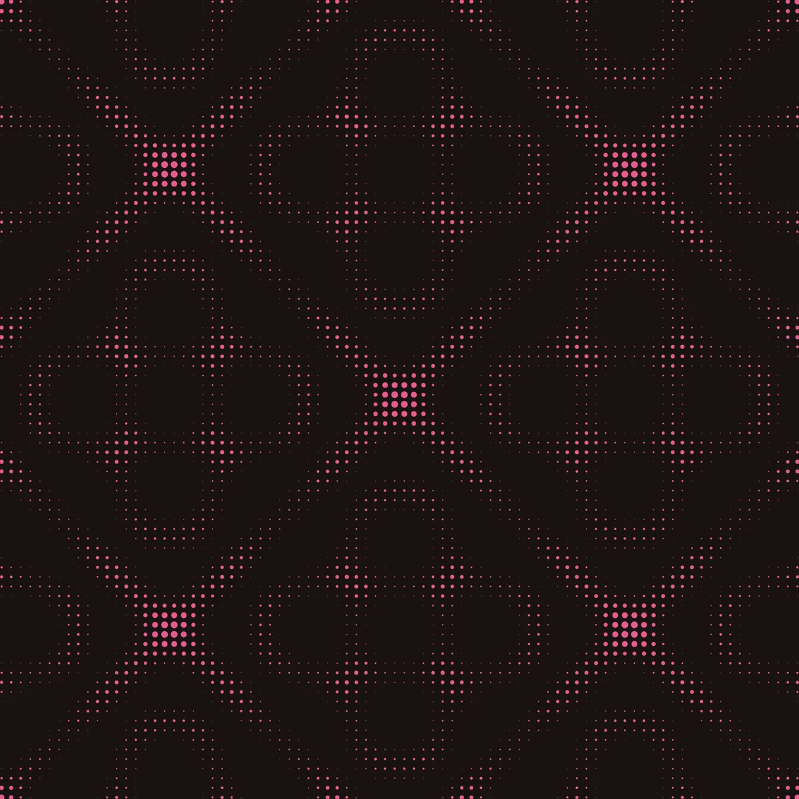 | `patterns.additional.web.diamond-mesh-pink.webp` | [Open WEBP](../assets/patterns/additional/web/diamond-mesh-pink.webp) | pink · 115,440 bytes |
|  | `patterns.additional.web.fine-cells-dark.webp` | [Open WEBP](../assets/patterns/additional/web/fine-cells-dark.webp) | dark · 40,020 bytes |
|  | `patterns.additional.web.fine-cells-light.webp` | [Open WEBP](../assets/patterns/additional/web/fine-cells-light.webp) | light · 34,354 bytes |
| 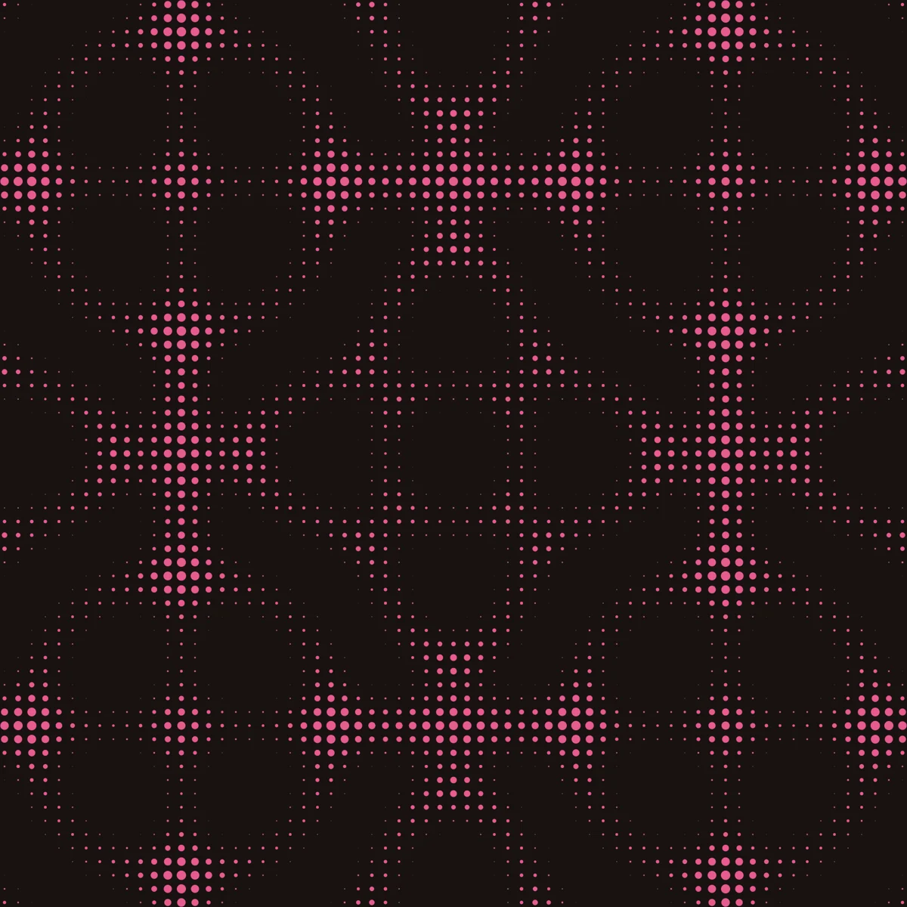 | `patterns.additional.web.fine-cells-pink.webp` | [Open WEBP](../assets/patterns/additional/web/fine-cells-pink.webp) | pink · 114,930 bytes |
|  | `patterns.additional.web.fine-lattice-dark.webp` | [Open WEBP](../assets/patterns/additional/web/fine-lattice-dark.webp) | dark · 40,520 bytes |
|  | `patterns.additional.web.fine-lattice-light.webp` | [Open WEBP](../assets/patterns/additional/web/fine-lattice-light.webp) | light · 35,096 bytes |
| 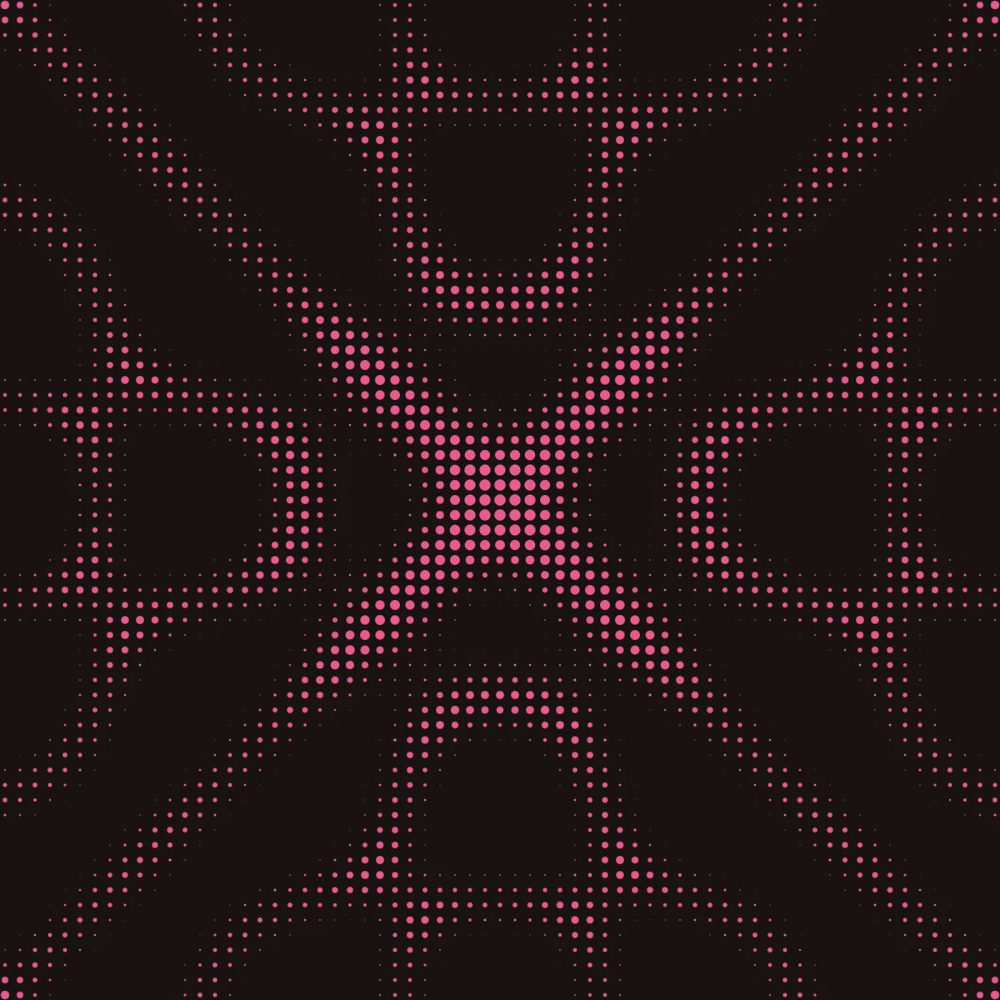 | `patterns.additional.web.fine-lattice-pink.webp` | [Open WEBP](../assets/patterns/additional/web/fine-lattice-pink.webp) | pink · 117,714 bytes |
|  | `patterns.additional.web.fine-rosette-dark.webp` | [Open WEBP](../assets/patterns/additional/web/fine-rosette-dark.webp) | dark · 107,808 bytes |
|  | `patterns.additional.web.fine-rosette-light.webp` | [Open WEBP](../assets/patterns/additional/web/fine-rosette-light.webp) | light · 89,900 bytes |
|  | `patterns.additional.web.fine-rosette-pink.webp` | [Open WEBP](../assets/patterns/additional/web/fine-rosette-pink.webp) | pink · 346,846 bytes |
|  | `patterns.additional.web.nested-rings-dark.webp` | [Open WEBP](../assets/patterns/additional/web/nested-rings-dark.webp) | dark · 57,976 bytes |
|  | `patterns.additional.web.nested-rings-light.webp` | [Open WEBP](../assets/patterns/additional/web/nested-rings-light.webp) | light · 46,158 bytes |
| 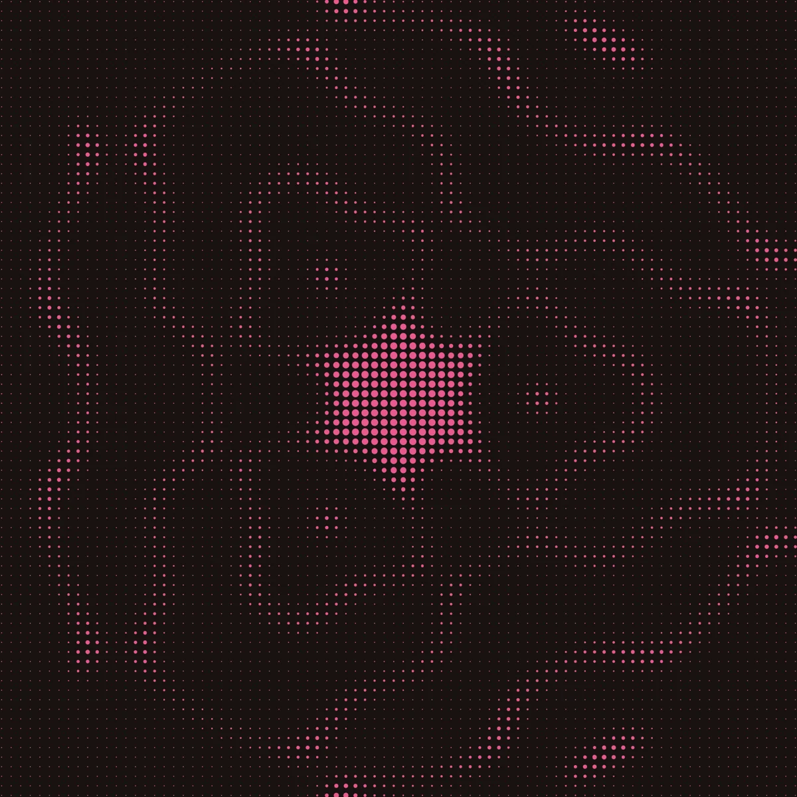 | `patterns.additional.web.nested-rings-pink.webp` | [Open WEBP](../assets/patterns/additional/web/nested-rings-pink.webp) | pink · 160,638 bytes |
|  | `patterns.additional.web.offset-loops-dark.webp` | [Open WEBP](../assets/patterns/additional/web/offset-loops-dark.webp) | dark · 65,532 bytes |
|  | `patterns.additional.web.offset-loops-light.webp` | [Open WEBP](../assets/patterns/additional/web/offset-loops-light.webp) | light · 57,660 bytes |
|  | `patterns.additional.web.offset-loops-pink.webp` | [Open WEBP](../assets/patterns/additional/web/offset-loops-pink.webp) | pink · 213,146 bytes |
|  | `patterns.additional.web.open-cells-dark.webp` | [Open WEBP](../assets/patterns/additional/web/open-cells-dark.webp) | dark · 64,250 bytes |
|  | `patterns.additional.web.open-cells-light.webp` | [Open WEBP](../assets/patterns/additional/web/open-cells-light.webp) | light · 56,608 bytes |
|  | `patterns.additional.web.open-cells-pink.webp` | [Open WEBP](../assets/patterns/additional/web/open-cells-pink.webp) | pink · 178,414 bytes |
|  | `patterns.additional.web.open-cross-dark.webp` | [Open WEBP](../assets/patterns/additional/web/open-cross-dark.webp) | dark · 53,338 bytes |
|  | `patterns.additional.web.open-cross-light.webp` | [Open WEBP](../assets/patterns/additional/web/open-cross-light.webp) | light · 50,168 bytes |
| 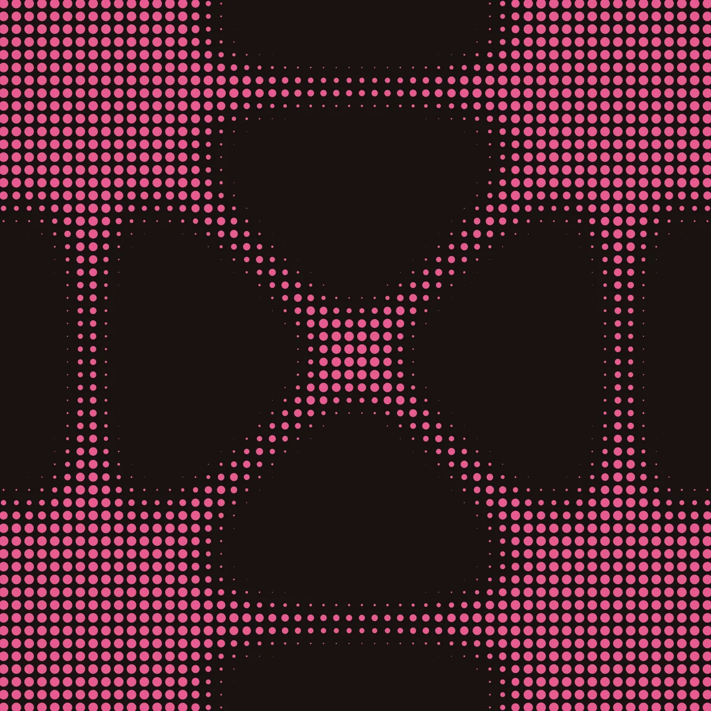 | `patterns.additional.web.open-cross-pink.webp` | [Open WEBP](../assets/patterns/additional/web/open-cross-pink.webp) | pink · 185,144 bytes |
|  | `patterns.additional.web.petal-rings-dark.webp` | [Open WEBP](../assets/patterns/additional/web/petal-rings-dark.webp) | dark · 48,434 bytes |
| 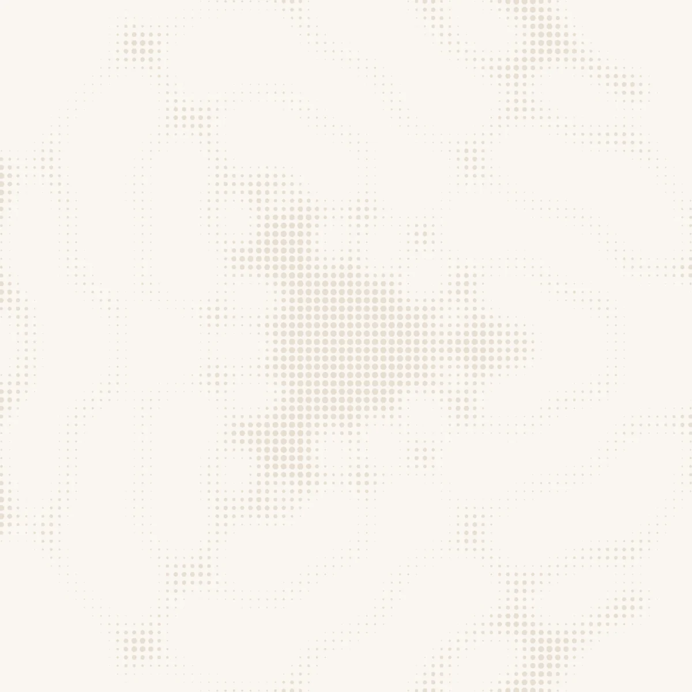 | `patterns.additional.web.petal-rings-light.webp` | [Open WEBP](../assets/patterns/additional/web/petal-rings-light.webp) | light · 40,176 bytes |
| 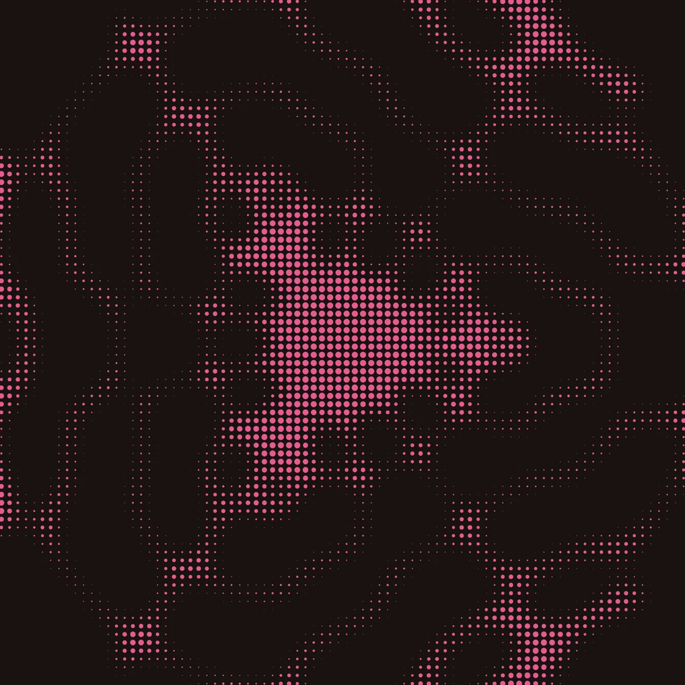 | `patterns.additional.web.petal-rings-pink.webp` | [Open WEBP](../assets/patterns/additional/web/petal-rings-pink.webp) | pink · 150,752 bytes |
|  | `patterns.additional.web.rounded-chambers-dark.webp` | [Open WEBP](../assets/patterns/additional/web/rounded-chambers-dark.webp) | dark · 40,572 bytes |
|  | `patterns.additional.web.rounded-chambers-light.webp` | [Open WEBP](../assets/patterns/additional/web/rounded-chambers-light.webp) | light · 34,378 bytes |
| 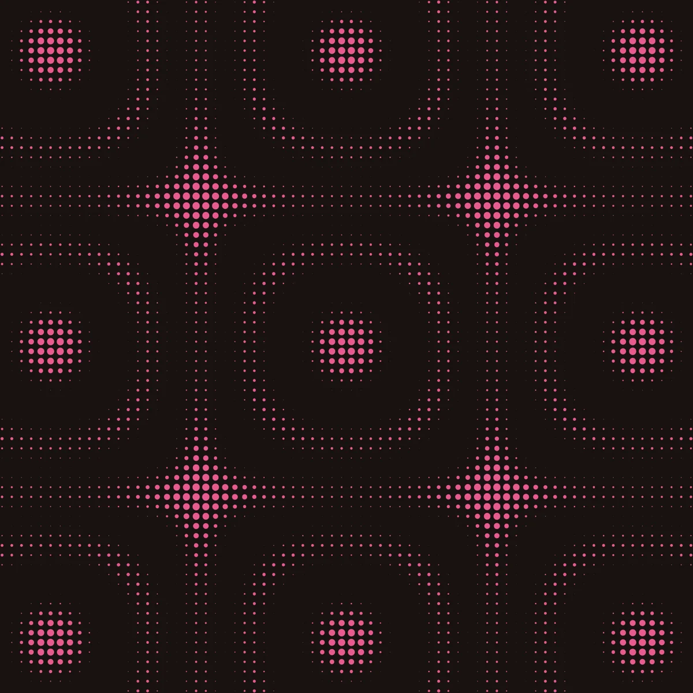 | `patterns.additional.web.rounded-chambers-pink.webp` | [Open WEBP](../assets/patterns/additional/web/rounded-chambers-pink.webp) | pink · 124,296 bytes |
|  | `patterns.additional.web.soft-petals-dark.webp` | [Open WEBP](../assets/patterns/additional/web/soft-petals-dark.webp) | dark · 33,246 bytes |
|  | `patterns.additional.web.soft-petals-light.webp` | [Open WEBP](../assets/patterns/additional/web/soft-petals-light.webp) | light · 28,038 bytes |
|  | `patterns.additional.web.soft-petals-pink.webp` | [Open WEBP](../assets/patterns/additional/web/soft-petals-pink.webp) | pink · 100,308 bytes |
|  | `patterns.additional.web.wide-arcs-dark.webp` | [Open WEBP](../assets/patterns/additional/web/wide-arcs-dark.webp) | dark · 45,826 bytes |
|  | `patterns.additional.web.wide-arcs-light.webp` | [Open WEBP](../assets/patterns/additional/web/wide-arcs-light.webp) | light · 38,794 bytes |
|  | `patterns.additional.web.wide-arcs-pink.webp` | [Open WEBP](../assets/patterns/additional/web/wide-arcs-pink.webp) | pink · 144,720 bytes |
