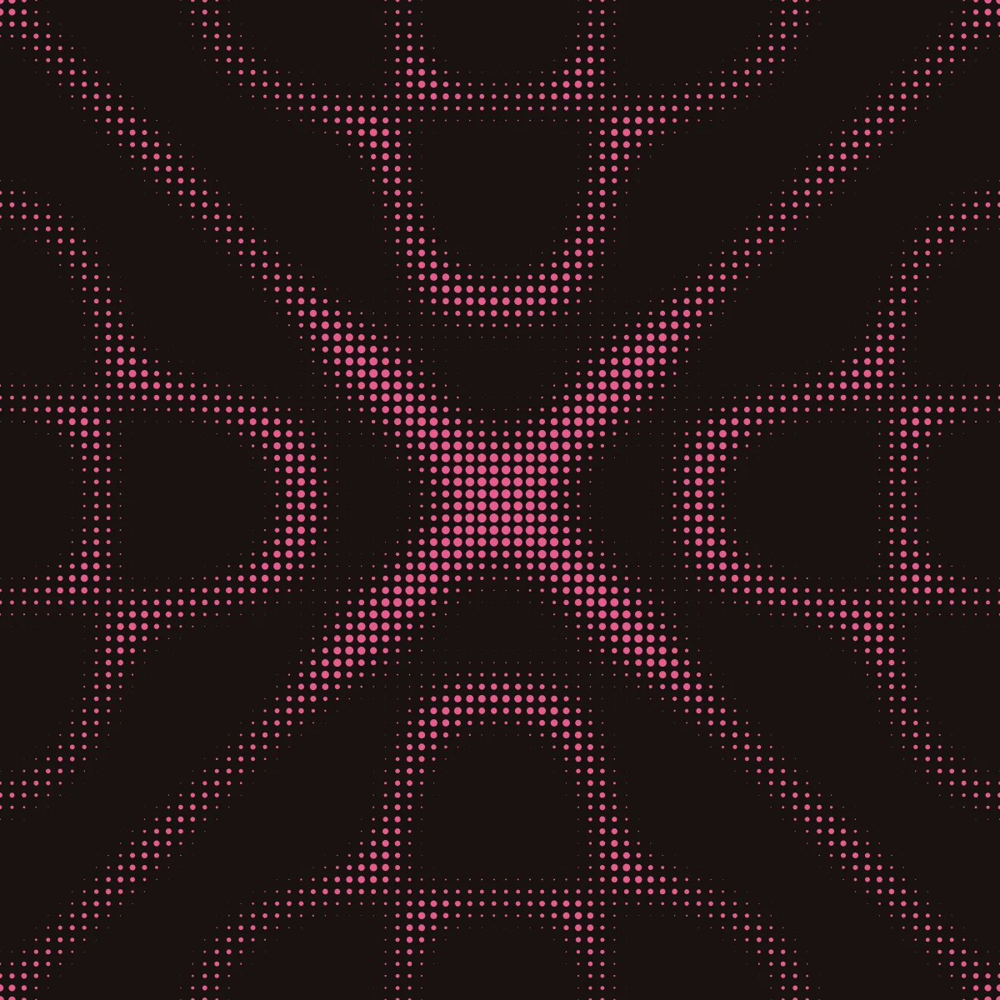
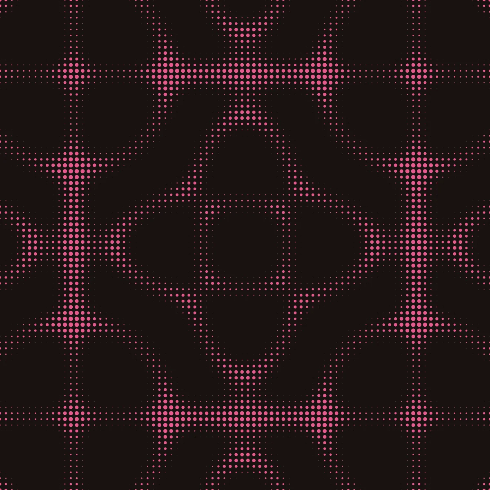
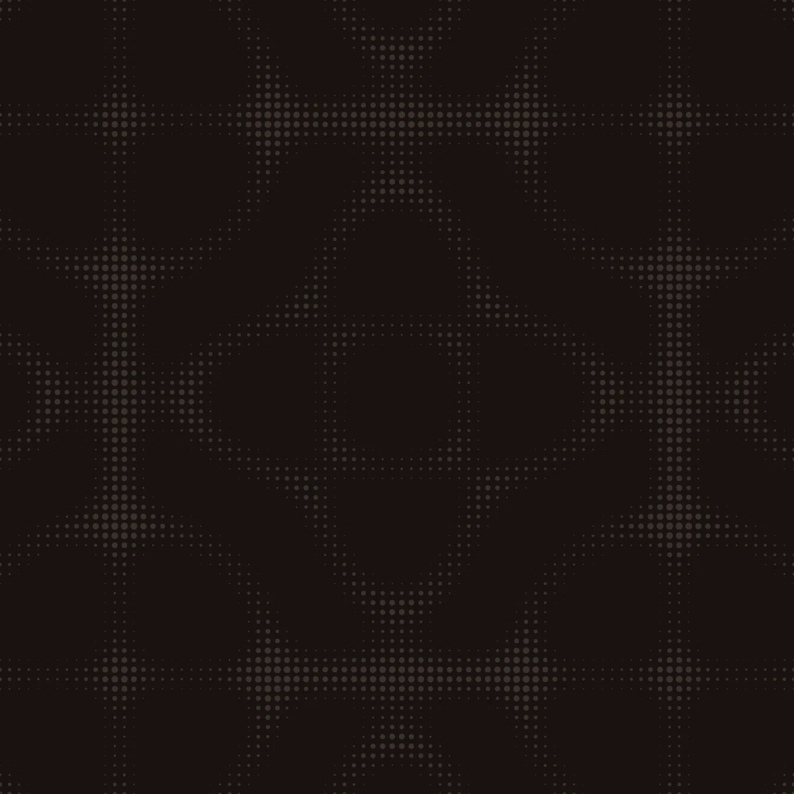
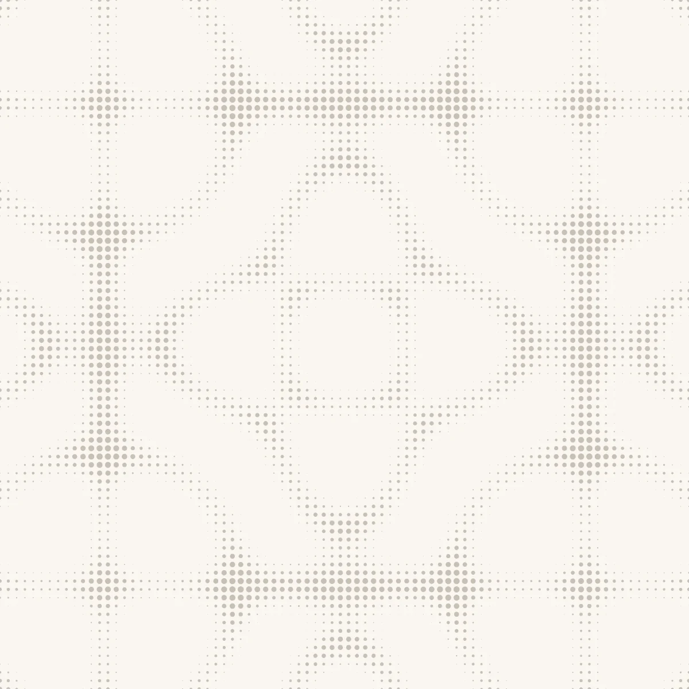
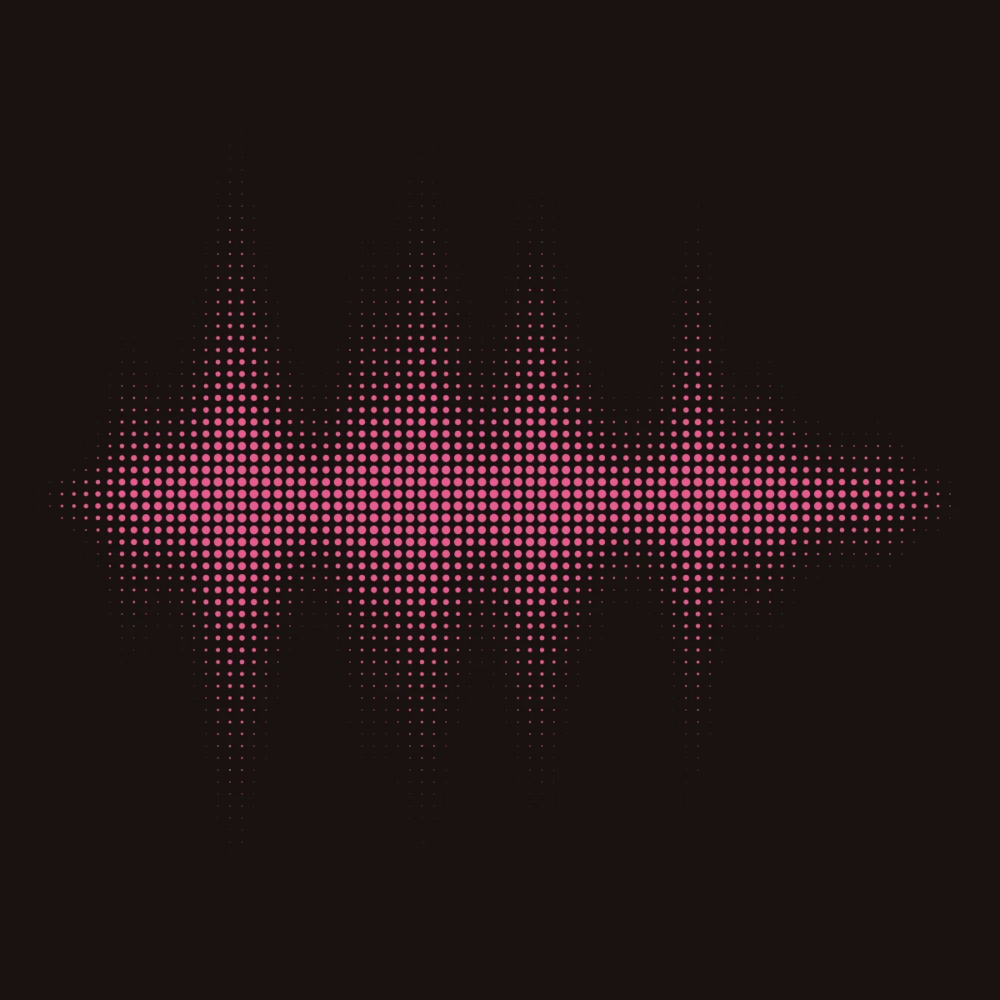
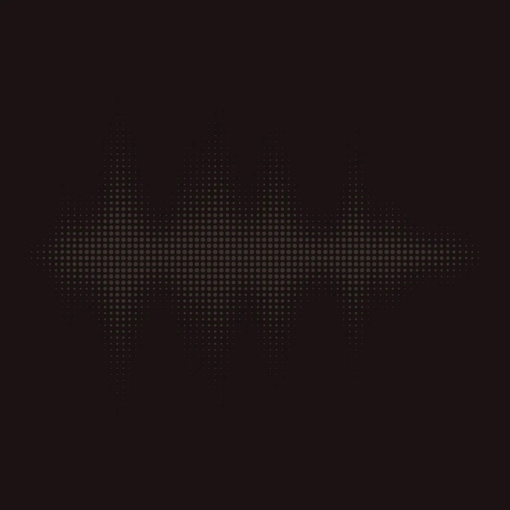
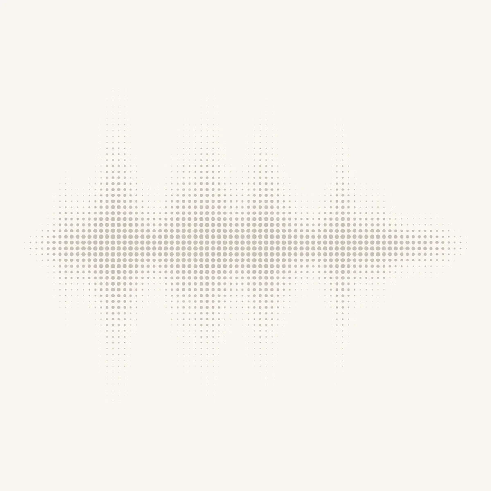
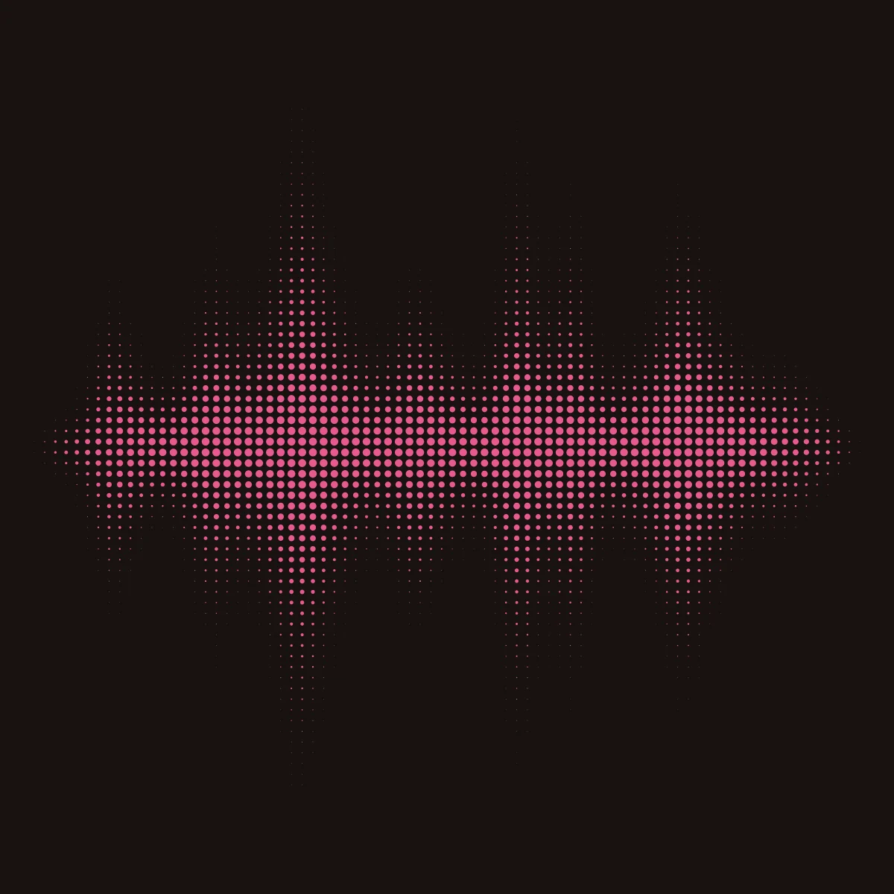
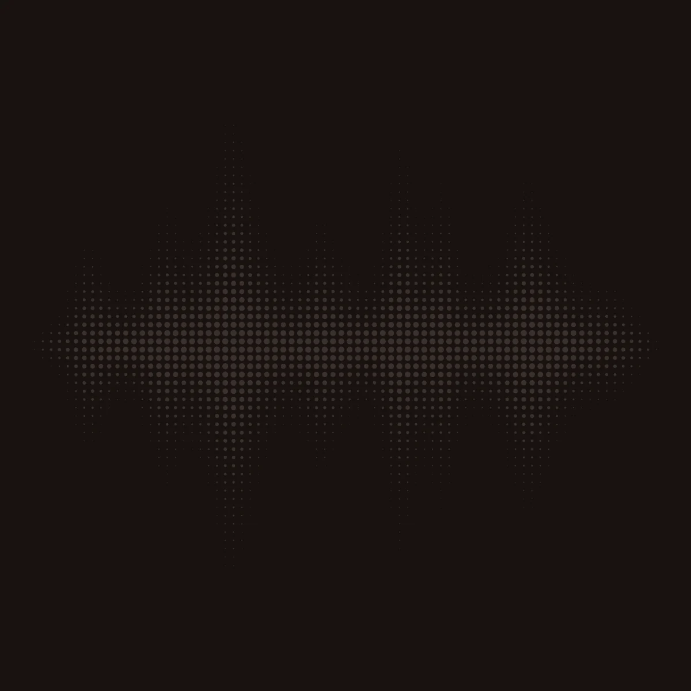
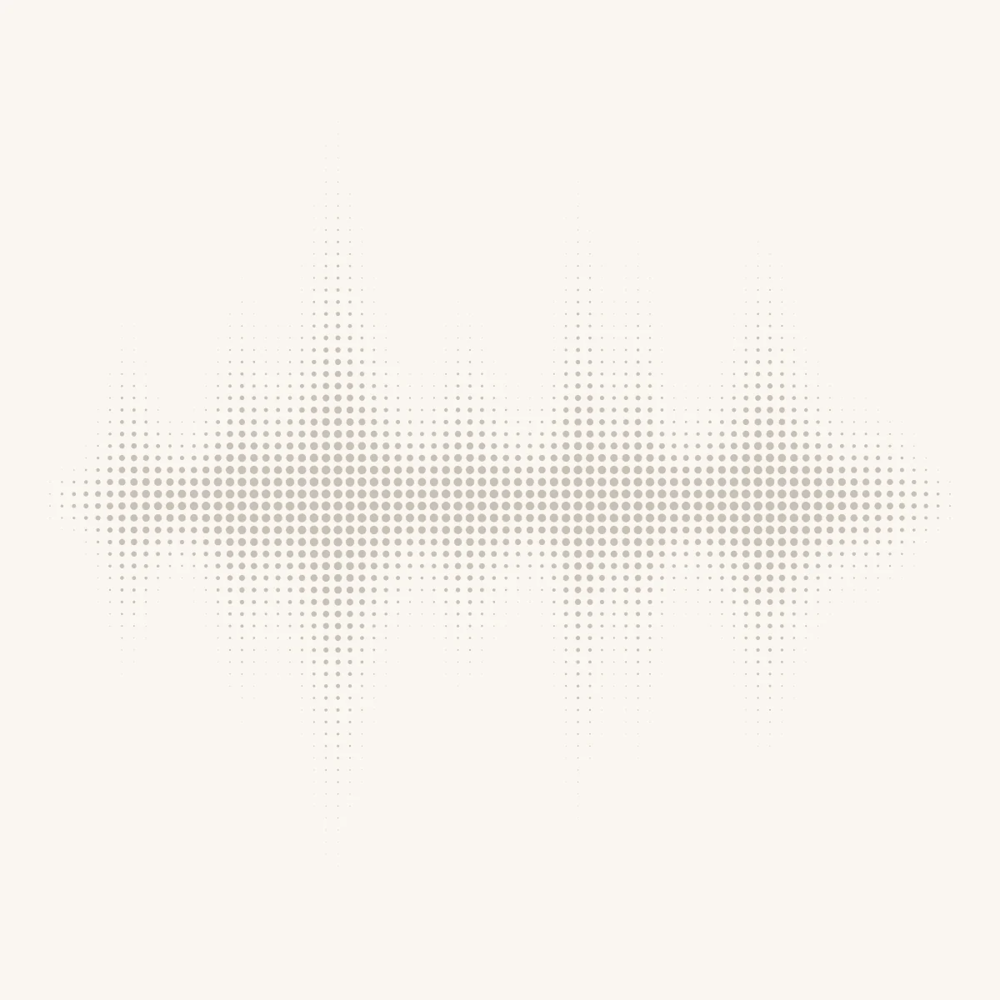

# Patterns reference

Two dotted patterns on one dot grid: Chladni (diagonal X or cross) and Soundwave (horizontal waveform), each in three treatments. Subtle dark: Taupe 800 dots on Taupe Dark. Subtle light: Taupe 300 dots on Taupe Light. Accent: Rasa Pink dots on Taupe Dark, hero moments only, never behind text. One pattern per layout; never mix Chladni and Soundwave; bleed off at least one edge; scale uniformly; the soundwave always runs horizontally; keep text areas clear. WebP files are web derivatives of the SVG masters.

[Selection workflow](../ASSETS.md) · [Production rules](assets.md)

Generated from `assets/catalog.json`; do not edit rows manually. Exact IDs include the file format.

| Preview | Exact asset ID | File | Usage / size |
| --- | --- | --- | --- |
|  | `brand-2026.Textures.web.rasa-chladni-01-accent.webp` | [Open WEBP](../assets/brand-2026/Textures/web/rasa-chladni-01-accent.webp) | dark · web-derivative · 146,966 bytes |
|  | `brand-2026.Textures.web.rasa-chladni-01-subtle-dark.webp` | [Open WEBP](../assets/brand-2026/Textures/web/rasa-chladni-01-subtle-dark.webp) | dark · web-derivative · 47,544 bytes |
|  | `brand-2026.Textures.web.rasa-chladni-01-subtle-light.webp` | [Open WEBP](../assets/brand-2026/Textures/web/rasa-chladni-01-subtle-light.webp) | light · web-derivative · 69,944 bytes |
|  | `brand-2026.Textures.web.rasa-chladni-02-accent.webp` | [Open WEBP](../assets/brand-2026/Textures/web/rasa-chladni-02-accent.webp) | dark · web-derivative · 153,728 bytes |
|  | `brand-2026.Textures.web.rasa-chladni-02-subtle-dark.webp` | [Open WEBP](../assets/brand-2026/Textures/web/rasa-chladni-02-subtle-dark.webp) | dark · web-derivative · 49,888 bytes |
|  | `brand-2026.Textures.web.rasa-chladni-02-subtle-light.webp` | [Open WEBP](../assets/brand-2026/Textures/web/rasa-chladni-02-subtle-light.webp) | light · web-derivative · 72,902 bytes |
|  | `brand-2026.Textures.web.rasa-soundwave-01-accent.webp` | [Open WEBP](../assets/brand-2026/Textures/web/rasa-soundwave-01-accent.webp) | dark · web-derivative · 91,590 bytes |
|  | `brand-2026.Textures.web.rasa-soundwave-01-subtle-dark.webp` | [Open WEBP](../assets/brand-2026/Textures/web/rasa-soundwave-01-subtle-dark.webp) | dark · web-derivative · 29,082 bytes |
|  | `brand-2026.Textures.web.rasa-soundwave-01-subtle-light.webp` | [Open WEBP](../assets/brand-2026/Textures/web/rasa-soundwave-01-subtle-light.webp) | light · web-derivative · 43,606 bytes |
|  | `brand-2026.Textures.web.rasa-soundwave-02-accent.webp` | [Open WEBP](../assets/brand-2026/Textures/web/rasa-soundwave-02-accent.webp) | dark · web-derivative · 89,784 bytes |
|  | `brand-2026.Textures.web.rasa-soundwave-02-subtle-dark.webp` | [Open WEBP](../assets/brand-2026/Textures/web/rasa-soundwave-02-subtle-dark.webp) | dark · web-derivative · 28,970 bytes |
|  | `brand-2026.Textures.web.rasa-soundwave-02-subtle-light.webp` | [Open WEBP](../assets/brand-2026/Textures/web/rasa-soundwave-02-subtle-light.webp) | light · web-derivative · 42,930 bytes |
